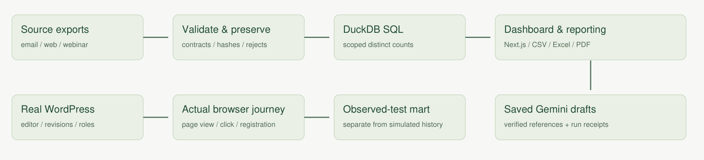

# CampaignOps

[Live dashboard](https://campaignops-digital-solutions.vercel.app) | [Methodology](https://campaignops-digital-solutions.vercel.app/methodology)

An independent campaign analytics and WordPress operations portfolio project. A reported performance drop becomes a traceable investigation: inspect tracking quality, review the content asset, fix a mobile registration path, and capture a real test journey.

**Evidence boundaries:** public WHO observance metadata; explicitly synthetic campaign activity; separately recorded WordPress browser tests. No real MSD data, patient records, clinical recommendations or claimed commercial lift.



## Quick start

Node 24 and Python 3.12+ are recommended.

```sh
python -m pip install -r requirements.txt
python -m pipeline.generate
python -m pipeline.build
python scripts/package-wordpress.py
python -m unittest discover -s tests -v
npm ci
npm run build:vercel
npm run start:vercel
```

The generated dataset and reports are committed so the dashboard works without Python or an API key. The Python rebuild is the source of truth. `npm run build` targets Sites/Vinext; `npm run build:vercel` targets standard Next.js.

## Workspaces

- Overview: scoped rates, campaign comparison and completeness.
- Campaigns: numerators, denominators and raw-source drilldown.
- Content operations: real WordPress editor, governance metadata, native statuses/revisions and an isolated browser journey ledger.
- Data health: rejected records, input hashes, mapping review and seeded investigations.
- Reports: searchable PDF, Excel, CSV and verified saved AI briefs.

## Data and contracts

`pipeline/generate.py` uses seed 73129. `data/raw` contains fictional email, web and webinar event exports. All files use the strict `events-v1` header in `pipeline/generate.py`. The `kind` column supplies source-specific requirements. UTC offset timestamps are required; UAE, Saudi Arabia and Qatar are AE, SA and QA. Supported provenance for historical imports is `synthetic`.

File hashes skip exact reimports. Matching event IDs collapse. Conflicting payloads sharing an ID are all quarantined. Mappings are explicit in `data/reference/mappings.json`; raw tags remain preserved. To approve the seeded tag repair, add `"Hepatitis_2026": "hepatitis"` and rebuild. No guessed matching occurs.

The SQL recalculates distinct messages, sessions and webinar/person pairs for each reporting scope using grouping sets. Monthly and weekly ratios are never averaged. Zero denominators are null. Only populated scopes appear in the artifact; the UI renders zero counts and undefined rates for empty scopes. Every report uses a fixed cutoff and includes the input fingerprint and calculation version. Public summary JSON excludes the raw ledger; source files load only on inspection.

See [metric definitions and architecture](docs/methodology.md) and [WordPress runbook](docs/wordpress.md).

## Optional saved AI briefs

Set `GEMINI_API_KEY` in your **local process environment**. Optionally set `GEMINI_MODEL`; the default is `gemini-3.5-flash-lite`. Do not paste a key into source, WordPress, GitHub or the public app.

```sh
python -m pipeline.brief
python -m pipeline.brief --campaign hepatitis
```

This makes a genuine provider call and writes a receipt with model, prompt and facts fingerprints, data hash, scope, timestamp and provider response. Unknown metric references and model-written numerical figures are rejected. Interpretation is a draft requiring human review. The public app only displays a matching saved draft; it has no live inference endpoint or model key. Reports work without AI.

## Verification

```sh
python -m unittest discover -s tests -v
npm run lint
npx tsc --noEmit
npm run build:vercel
node qa/browser.mjs http://localhost:3000
```

Browser verification uses Playwright and axe. Install Chromium with `npx playwright install --with-deps chromium`. Automated accessibility checks cover only detectable issues, not a complete accessibility certification. WordPress verification boots actual WordPress, exercises native publishing and revision restore, captures a real mobile journey, and imports the exported ledger into the separate observed-test mart.

The `.github/workflows/verify.yml` workflow rebuilds the data and runs checks from a clean checkout. It runs on pushes, manual dispatch and a weekly Monday schedule. Scheduled GitHub runs are best effort and may pause after prolonged repository inactivity. It does not call the model or require secrets.

Recorded results and limits: [verification record](docs/verification.md).

## Public source attribution

Public WHO observance references appear in `data/reference/campaigns.json`. Content copy is original. No WHO imagery, brand assets or articles are redistributed. See the in-app Methodology page for analytics and WordPress documentation links.

Application and pipeline source: MIT. The WordPress plugin: GPL-2.0-or-later. The dependency licenses remain their own.
