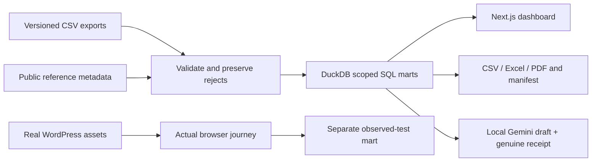

# Calculation and evidence model

Email click rate counts delivered message IDs with a qualifying human click. A second click does not add a second message; bot clicks do not qualify. Engagement follows the explicit landing-session rule: more than ten seconds, two or more pageviews, or registration. Registration rate uses landing sessions, not pageviews. Webinar attendance counts distinct registered webinar/person pairs with positive attendee time and collapses rejoins; presenters and organizers do not qualify.

Each metric groups by entity **inside each reporting scope**. Counts are not summed from daily distincts. Period membership uses the timestamp of each event in Asia/Dubai. Weekly attendance can exclude a registration from another week; unmatched attendees remain visible in the mart. This is an event-window report, not a longitudinal cohort analysis.

Three scenarios deliberately coexist: an unmapped case-sensitive campaign tag; an identical webinar file plus rejoin records; and a mobile action hidden by a seeded WordPress condition. Tag repair reclassifies existing records only. A passing mobile test verifies current behavior only. No before/after business lift is fabricated.

The input fingerprint covers the raw import manifest, approved mapping, report cutoff and calculation source hashes. Report metadata also includes a semantic calculation version and timezone. Rejected rows retain source file, line, raw payload and reason. `public/data/quality.json` is a fictional-data ledger; no private job descriptions or mail are included.

The metric registry defines numerator, denominator and display labels. The same SQL output feeds the dashboard, CSV, workbook and PDF. AI drafts reference registry IDs, never their own numerical calculations. Exact scope and data hash must match before display. Structural validation does not establish causal or semantic truth; human review remains required.
